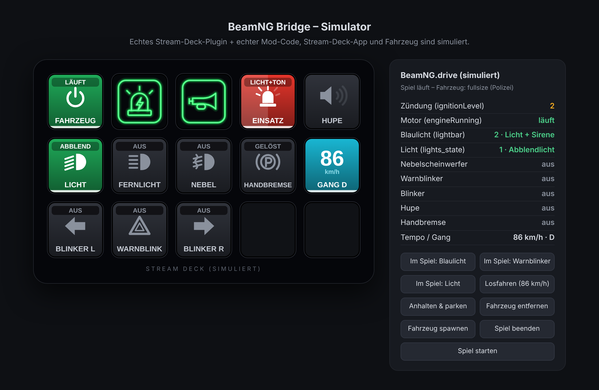
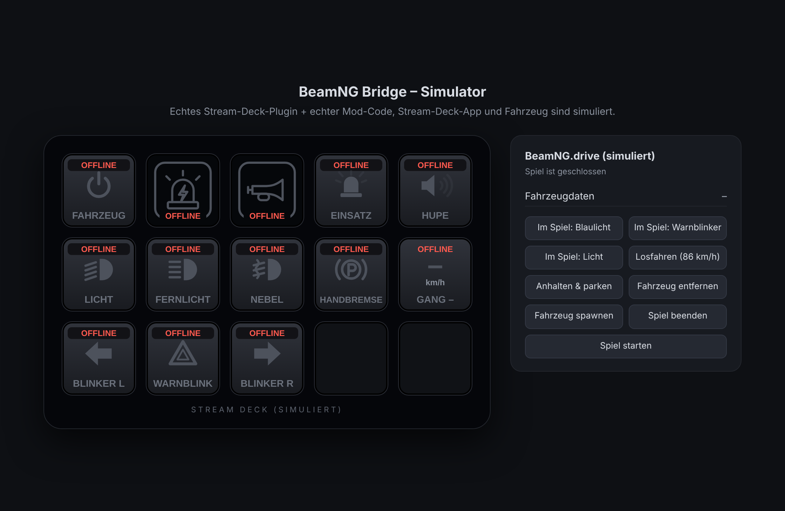
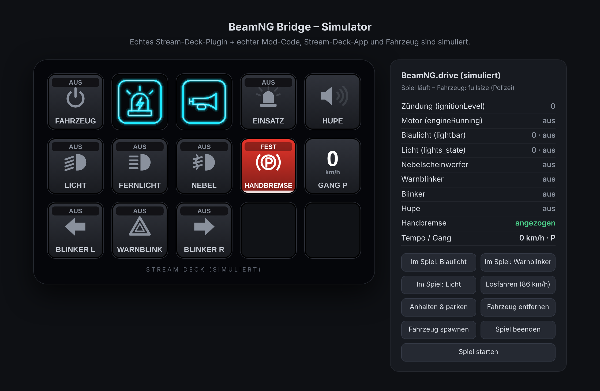
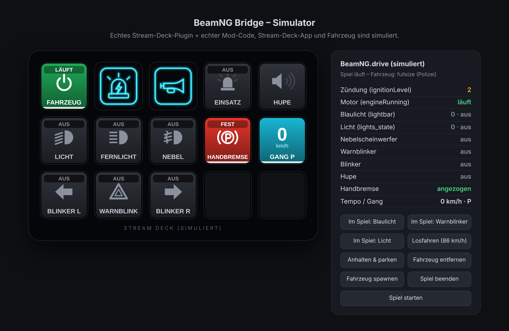
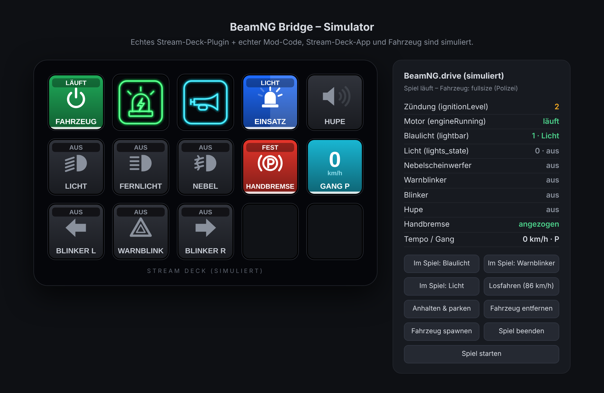
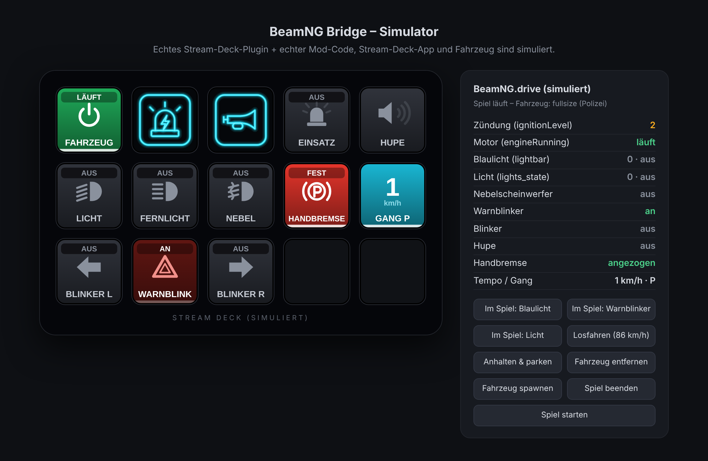

# BeamNG Bridge – BeamNG.drive per Stream Deck steuern

Fahrzeugfunktionen in BeamNG.drive über ein Elgato Stream Deck schalten: Fahrzeug ein/aus,
Blaulicht, Sirene, Licht, Blinker und mehr. Die Tasten sind **dynamisch**: Sie zeigen live,
was im Spiel gerade aktiv ist – auch wenn du etwas per Tastatur im Spiel umschaltest.



Das Projekt besteht aus zwei Teilen, die per UDP (Standard `127.0.0.1:4455`) miteinander sprechen:

| Teil | Ordner | Fertige Datei |
| --- | --- | --- |
| BeamNG-Mod (Lua) | `beamng-mod/` | `dist/beamng_streamdeck_bridge.zip` |
| Stream-Deck-Plugin (Node.js) | `streamdeck-plugin/` | `dist/com.maxbaumann.beamng.streamDeckPlugin` |

## Installation

1. **Mod:** `dist/beamng_streamdeck_bridge.zip` (nicht entpacken) in den Mods-Ordner von BeamNG kopieren,
   z. B. `%LOCALAPPDATA%\BeamNG.drive\<Version>\mods\` (bzw. `%LOCALAPPDATA%\BeamNG\BeamNG.drive\current\mods\`
   bei neueren Versionen). Im Spiel unter *Mods* prüfen, dass sie aktiv ist.
2. **Plugin:** `dist/com.maxbaumann.beamng.streamDeckPlugin` doppelklicken – die Stream-Deck-Software
   (ab Version 6.5) installiert es.
3. In der Stream-Deck-Software die Aktionen aus der Kategorie **BeamNG Bridge** auf Tasten ziehen.
4. BeamNG starten und in ein Fahrzeug setzen. Die Tasten wechseln von `OFFLINE` auf den Live-Zustand.

## Tasten

| Taste | Druck | Anzeige |
| --- | --- | --- |
| Fahrzeug Ein/Aus | startet den Motor bzw. schaltet alles aus (Option: nur Zündung) | AUS · ZÜNDUNG · LÄUFT (E-Auto: BEREIT) |
| Blaulicht | Blaulicht an/aus, ohne Sirene | Neon-Symbol: cyan = aus, **komplett grün = an** |
| Sirene | Sirene an/aus; schaltet das Blaulicht bei Bedarf mit ein | Neon-Symbol: cyan = aus, **komplett grün = an** |
| Einsatz | schaltet durch: Aus → Blaulicht → Blaulicht + Sirene | blau blinkend / rot blinkend |
| Hupe | hupt, solange gedrückt | |
| Licht | Aus → Abblendlicht → Fernlicht | AUS · ABBLEND · FERNLICHT |
| Fernlicht, Nebel | an/aus | AN · AUS |
| Blinker L/R, Warnblinker | an/aus | blinkt im Takt des Fahrzeugs |
| Handbremse | ziehen/lösen | FEST · GELÖST |
| Tempo & Gang | – | km/h oder mph, eingelegter Gang |

Die Tasten hängen voneinander ab: Sirene einschalten macht auch die Blaulicht-Taste grün,
Blaulicht ausschalten schaltet die Sirene mit ab, Fernlicht ändert die Licht-Taste usw.
Ohne Spiel zeigen alle Tasten `OFFLINE`, ohne Fahrzeug `KEIN FZG`; ein Druck zeigt dann das Warnsymbol.

| | |
| --- | --- |
|  Spiel geschlossen |  verbunden, alles aus |
|  Motor läuft |  Blaulicht an, Sirene aus |
|  Blaulicht + Sirene, Licht, 86 km/h |  Warnblinker **im Spiel** eingeschaltet |

Die Screenshots stammen aus dem mitgelieferten Simulator (siehe unten), nicht aus dem echten Spiel.

## Einstellungen

- **Stream Deck:** Im Einstellungsbereich jeder Taste lassen sich *BeamNG Host* und *Port* ändern (gilt für alle Tasten).
- **BeamNG:** optional `settings/streamdeckBridge.json` im BeamNG-Benutzerordner anlegen:

  ```json
  { "address": "127.0.0.1", "port": 4455, "rate": 15 }
  ```

  Läuft die Stream-Deck-Software auf einem anderen PC, hier `"address": "0.0.0.0"` setzen, im Plugin die
  IP des Spiele-PCs eintragen und den UDP-Port in der Firewall freigeben.

## Stand der Tests

Die Mod und das Plugin wurden **nicht im echten BeamNG.drive und nicht auf echter Stream-Deck-Hardware
getestet** – beides stand bei der Entwicklung nicht zur Verfügung. Getestet ist:

- das gebaute Plugin gegen eine nachgebaute Stream-Deck-App (gleiches WebSocket-Protokoll),
- der unveränderte Lua-Code der Mod in einer Lua-VM mit nachgebauter BeamNG-Umgebung und simuliertem Fahrzeug,
- beides zusammen über echtes UDP (`npm test`, 11 End-to-End-Tests), Lua kompiliert unter LuaJIT (wie in BeamNG),
- das Manifest mit dem offiziellen Elgato-Validator.

Die BeamNG-Funktionen (`electrics.set_lightbar_signal`, `electrics.setIgnitionLevel`, …) sind nach bestem
Wissen gewählt und mit Ausweichwegen abgesichert. Falls im Spiel etwas nicht reagiert: Konsole mit `~` öffnen
und nach `streamdeckBridge` / `streamdeckAgent` suchen.

## Fehlersuche

- **Tasten bleiben `OFFLINE`:** Mod aktiv? In der BeamNG-Konsole muss
  `Listening for the Stream Deck plugin on 127.0.0.1:4455` stehen. Port im Plugin und in der Mod gleich?
- **`KEIN FZG`:** Du sitzt in keinem Fahrzeug (Menü, freie Kamera ohne Fahrzeug).
- **Blaulicht/Sirene ohne Wirkung:** Das Fahrzeug braucht eine Lichtanlage (Polizei-, Feuerwehr-, Rettungsvarianten).

## Entwicklung

```bash
cd streamdeck-plugin
npm install
npm run build   # Manifest + Bilder erzeugen, bündeln, validieren
npm test        # End-to-End-Tests
npm run sim     # Simulator im Browser: http://localhost:8377
npm run pack    # dist/ neu erzeugen
```

- `beamng-mod/lua/ge/extensions/streamdeckBridge.lua` – UDP-Server im Spiel; enthält auch den Code, der im Fahrzeug läuft.
- `streamdeck-plugin/src/actions.js` – Verhalten und Aussehen jeder Taste je nach Fahrzeugzustand.
- `streamdeck-plugin/src/render.js` – zeichnet die Tastenbilder (SVG).
- `streamdeck-plugin/simulator/` – nachgebaute Stream-Deck-App und nachgebautes BeamNG für Tests.

### Protokoll (UDP, JSON)

Plugin → Mod: `{"t":"hello","v":1}` (jede Sekunde) und `{"t":"cmd","id":"lightbar","a":"toggle"}`
(`a`: `toggle`, `on`, `off`, `set` mit `val`, `press`, `release`).
Mod → Plugin: `{"t":"state","v":1,"veh":true,"name":"fullsize","s":{"ign":2,"run":true,"lb":1,…}}`.
